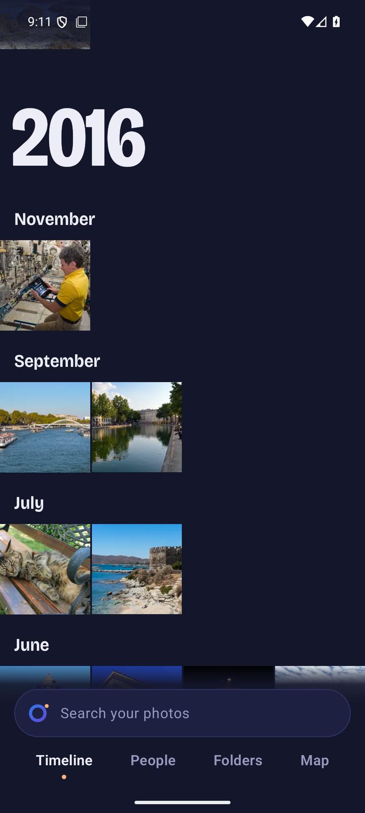
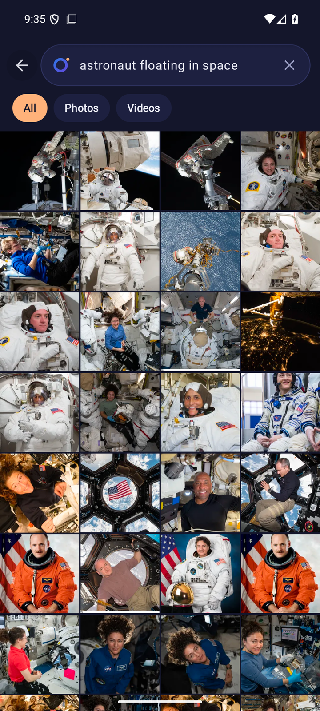
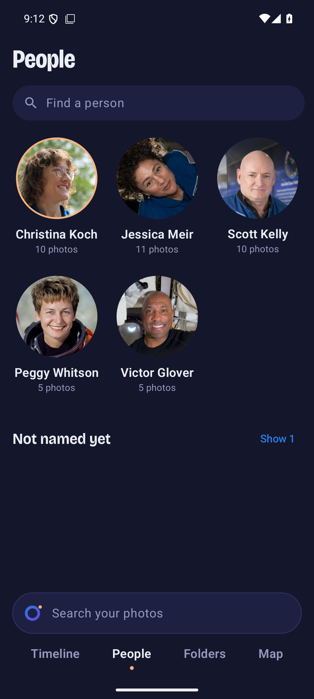
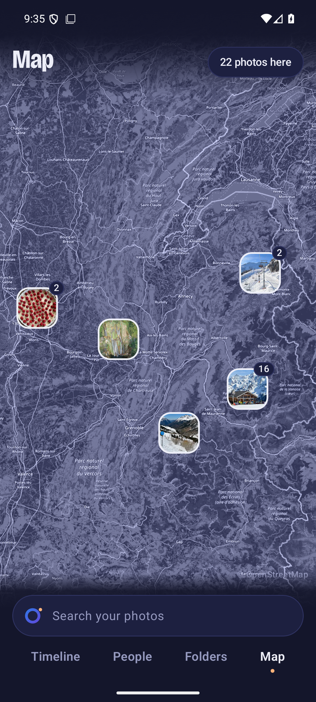
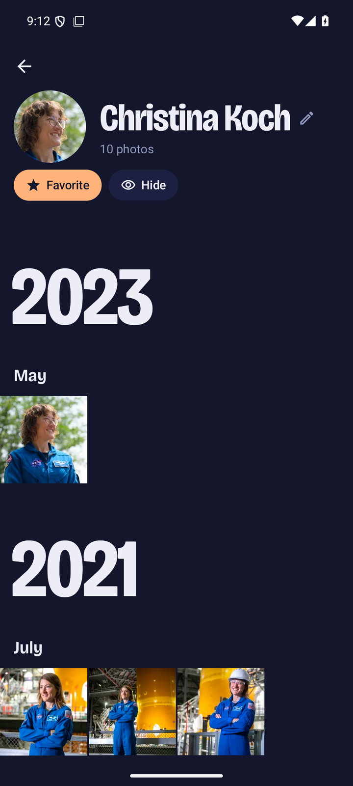
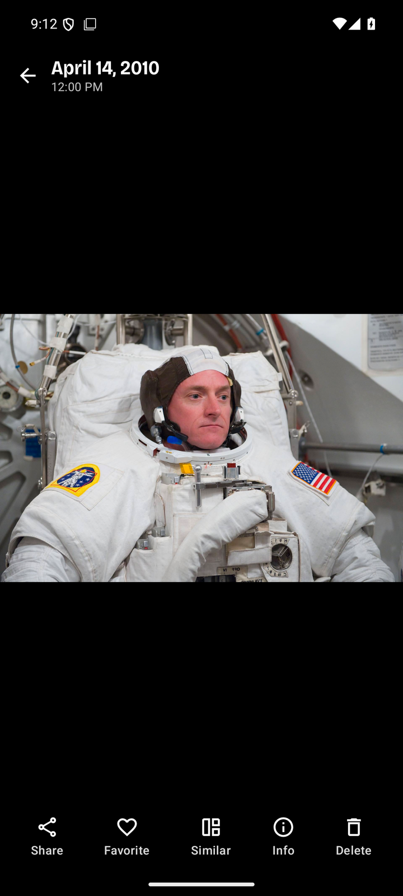
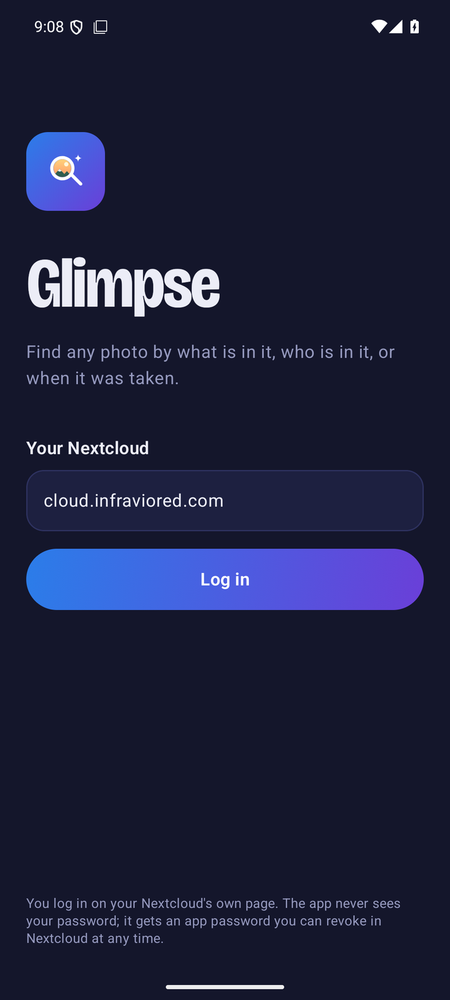
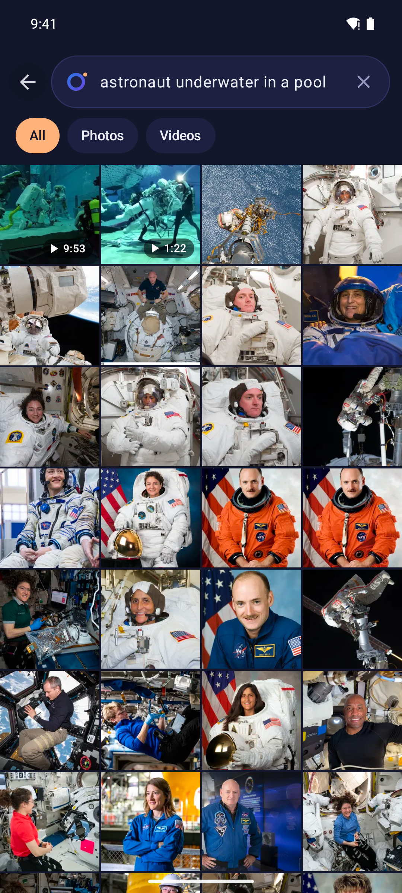
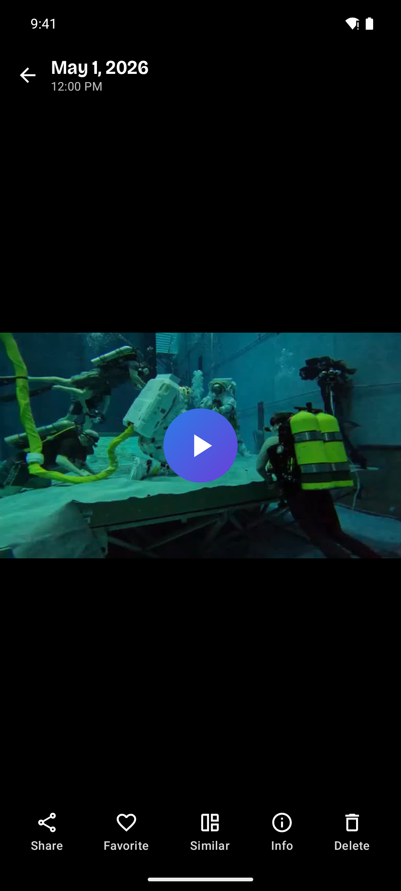
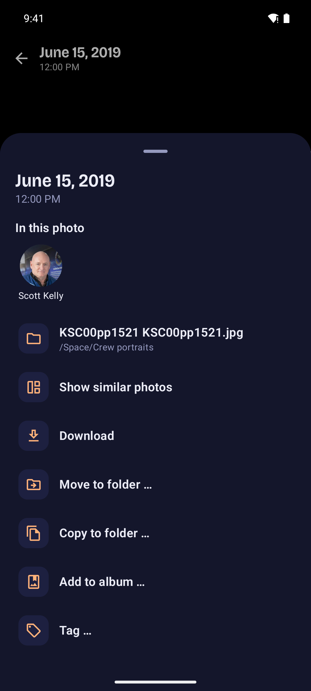

<h1 align="center">Glimpse for Android</h1>

<p align="center">
  <b>Your Nextcloud photos, searchable by what is in them, in your pocket.</b><br>
  A native Android app for <a href="https://github.com/Infraviored/nextcloud-immich-search">Glimpse</a>,
  the Nextcloud app that finds photos by content and by the people in them, powered by your own
  <a href="https://immich.app">Immich</a>.
</p>

<p align="center">
  
  
  
  <a href="LICENSE"></a>
</p>

<p align="center">
  
  
  
  
</p>
<p align="center">
  
  
  
</p>
<p align="center">
  
  
  
</p>
<p align="center"><sub>Search finds the moment inside a video and plays it from there. Info shows when, who and where, and what to do next.</sub></p>

---

Type "beach at sunset" or a friend's name and get the picture, from the photos you already keep in
Nextcloud. There is no second cloud and no extra account: the app talks to your Nextcloud, and
Nextcloud decides what you may see.

## Features

- **Search by content.** The search lens sits at the bottom of every screen. Describe what is in
  the picture, narrow the results to photos, videos, a person or a tag, and come back to recent
  searches.
- **Search inside videos.** With "Search inside videos" on in Glimpse, a search also finds the
  moment in a video: the result shows that still with its time, and the video plays from there.
- **Timeline.** All your pictures in year bands, newest first, with "On this day" memories. Drag
  the year scrubber to jump to any year, keep scrolling in both directions, and go "Back to today".
- **People.** Everyone Immich recognised in pictures you can open. Rename a person in place,
  favorite or hide them, merge two that are the same, and take wrong pictures out of a person.
- **Map.** Your geotagged pictures as pins on a map in the app's colours; tap a pin for its
  pictures. The map tiles come through your Nextcloud.
- **Folders.** Your Nextcloud folders as galleries.
- **Viewer.** Zoom into photos and play videos. The picture's folder sits above the actions
  (tap to open it). Below the picture: share, favorite, similar, info and delete; the info sheet shows the date, who is in the photo and its folder, and offers
  download, move, copy, album and tag.
- **Do things with many at once.** Select pictures (long-press), then share, favorite, download,
  move or copy them to a folder (with undo), add them to an album, tag them, or delete them
  (they go to the Nextcloud trash bin).
- **Private area.** Mark pictures private; they only show after you unlock with your Nextcloud
  password, and lock again with one tap.
- **Sensitive pictures** (when your server allows it and you turned it on in Glimpse's settings
  on the web): recognised pictures carry a small mark; the eye at the top shows all, hides them
  or shows only them, and you mark a picture as sensitive or not with one tap in the viewer.
  "Train the sensitive filter" shows what the filter lets through and what it hides, side by
  side; hide or bring back a selection and it learns from that in the background.
- **Duplicates.** Groups of near-identical pictures, with Immich's pick of what to keep; delete
  the rest in one go or mark a group as not duplicates.
- **Light and dark**, following the system setting, in Glimpse's design. English and German.

## Requirements

- **A Nextcloud with the [Glimpse app](https://github.com/Infraviored/nextcloud-immich-search)**
  installed and enabled for you, connected to an Immich server. The app checks this when you
  log in and tells you if Glimpse is missing.
- **Android 10** or newer.

## Install

1. Download the latest APK from
   [Releases](https://github.com/Infraviored/glimpse-android/releases) and open it on your phone.
   Android asks once whether your browser or file manager may install apps.
2. Open Glimpse and enter your Nextcloud address, e.g. `cloud.example.com`.

## How the login works

1. You enter your Nextcloud address.
2. Nextcloud's own login page opens in the browser
   ([Login Flow v2](https://docs.nextcloud.com/server/latest/developer_manual/client_apis/LoginFlow/index.html)).
   Your password, two-factor authentication and single sign-on all stay with Nextcloud. **The app
   never sees your password.**
3. After you allow access, Nextcloud gives the app an **app password**. The app stores it
   encrypted, with a key from the Android keystore. You can see and revoke it in Nextcloud under
   *Settings → Security → Devices & sessions*.

*Log out* (tap your avatar) deletes the app password on the server and in the app.

## Build

```bash
echo "sdk.dir=/path/to/android-sdk" > local.properties
./gradlew testDebugUnitTest assembleDebug        # app/build/outputs/apk/debug/
./gradlew assembleRelease                        # signed only with keystore.properties, see app/build.gradle.kts
```

- Debug builds install next to release builds as `com.infraviored.glimpse.debug`.
- Release builds are minified.
- The APK carries no Google dependency metadata, so it is suitable for F-Droid.

Stack:

- Kotlin and Jetpack Compose (Material 3)
- OkHttp
- Coil 3 with telephoto for zooming
- Media3 ExoPlayer

The app only uses Glimpse's JSON API (`/apps/glimpse/api/…`) and Nextcloud's login and WebDAV
endpoints. Thumbnails come through Glimpse, which checks permissions on the server.

## License

AGPL-3.0-or-later, like Glimpse itself. The Bricolage Grotesque font is under the SIL Open Font
License ([licenses/OFL-BricolageGrotesque.txt](licenses/OFL-BricolageGrotesque.txt)).
